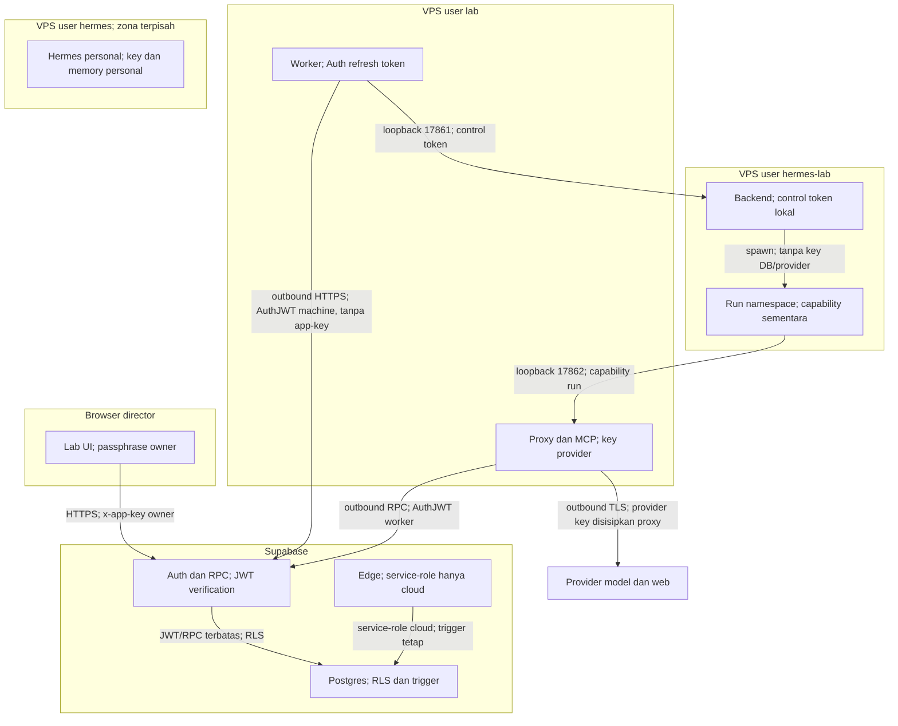
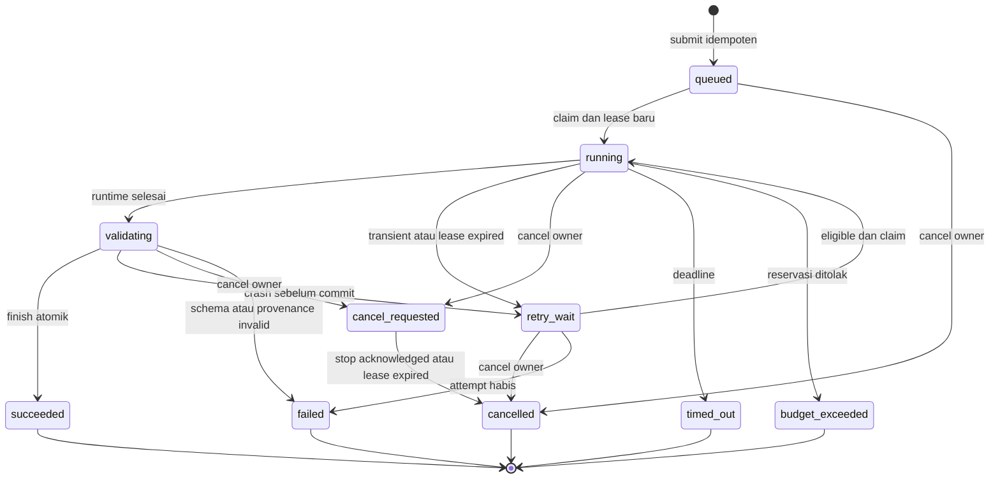

# Arsitektur integrasi

Keputusan utama: Lab mengantrekan unit kerja yang tahan tab ditutup; worker mengeksekusinya melalui Hermes tanpa memegang kuasa director. Phase 1 mengirim hasil langsung ke director’s room, kemudian Phase 2 menghubungkan state machine institusi yang sudah ada. Audit source di 01/02 menjadi dasar, bukan catatan desain lama.

Konvensi angka: waktu/kapasitas/anggaran bertanda “desain” bersumber ADR-003/006/009; bukan hasil pengukuran live. Angka biaya provider bersumber tautan bertanggal di 6.16. Kode, JSON, SQL, version dan identifier memakai sintaks native bertitik; prose memakai titik ribuan dan koma desimal.

## 6.1 Komponen dan trust boundary

Tidak ada panggilan masuk dari Supabase ke VPS. Diagram berikut memberi label pemilik credential pada setiap hubungan lintas zona.

Tidak ada edge ke zona personal: permission Unix, private mount/PID namespace dan egress rule mencegah akses. Admin `hermesagent` tetap memiliki kuasa root untuk instalasi manual; tidak digunakan worker. Keputusan ADR-001/002/006.

## 6.2 Lifecycle job

At-least-once eksekusi, hasil kanonik tunggal. Bukan exactly-once biaya provider.

Lease/heartbeat/backoff/deadline ADR-003 berlaku semua attempt. Claim memegang advisory transaction lock global, reap expired, lalu `FOR UPDATE SKIP LOCKED`. Worker crash/reboot tidak melanjutkan session lama: attempt baru home baru, budget sisa, context snapshot sama. Fencing `(worker_id, job_id, attempt, lease_token)` wajib pada semua operasi. `finish` mengunci job; hash payload dan unique job result menjadikan replay respons sama, payload berbeda conflict. Commit final dan director pointer dalam satu transaksi. Cancel sesudah commit sukses adalah no-op “already_succeeded”; cancel yang lebih dulu memperoleh row lock menang.

## 6.3 Antrean

Antrean di `os_lab_hermes_jobs`, attempt di `os_lab_hermes_attempts`, ledger private dan event append-only. Default satu run aktif secara global, termasuk validating/cancel_requested; setting tidak boleh melebihi satu sebelum resource test. Lease kedaluwarsa direap setiap claim, bukan menunggu cron. Idle worker tetap heartbeat. Realtime wake row hanya hint, polling tetap berjalan. Prioritas brief > standard > full; ageing setiap lima menit menaikkan prioritas job lama sampai batas brief agar full tidak lapar. Urutan tie created_at/id deterministik. Semua angka scheduling adalah desain ADR-003/009.

## 6.4 Kontrak worker ↔ Supabase

Auth machine user tidak mempunyai direct table write atau akses owner. `lab_worker_claim`, `heartbeat`, `events`, `archive`, `read_corpus`, `reserve`, `settle`, `validating`, `finish`, `fail` semuanya definer terbatas; nama lengkap/signature/error di 04. Registry revoke berlaku pada setiap RPC termasuk refresh lease. Submission owner membuat brief/assignment/job atomik dan menyimpan snapshot versi/config. JSON Schema mengikat output/provenance/usage/model/SHA/error. SQL draft sengaja di docs; tidak applied dalam desain.

Pairing code dari owner UI dipakai sekali selama sepuluh menit (desain ADR-001). Edge enrol menyimpan service-role hanya di cloud, membuat Auth user tanpa membership dan mengembalikan sesi ke proses `labctl pair`. Refresh token 0600 hanya user lab. UI tidak pernah mengirim service-role. Rotasi mematikan registry lama dulu, membatalkan lease, lalu enroll token baru. Semua request HTTPS; log header/body auth dilarang.

## 6.5 Kontrak worker ↔ Hermes

Backend adapter di loopback menerima frozen request dari worker, bukan query SQL. Control token per startup dibaca worker melalui grup lab-bridge, tidak dimount ke run bwrap. Child baru mengimpor AIAgent H. Prompt tersusun: kebijakan role/tool/provenance → active version prompt → brief/assignment terstruktur → corpus yang sengaja diberikan. Corpus selalu delimited sebagai data tak dipercaya. Tidak memuat rubric, expected_answer, prompt reviewer lain, atau sesi personal.

`SKILL.md` berasal active `os_inst_agent_versions`; references versi itu dari tabel baru `os_lab_agent_files`. Path relatif tanpa `..`, symlink, executable hook atau inline shell; SHA diverifikasi; mount skill read-only. Konfigurasi memory/curator/skill mutator/session_search dimatikan sebagaimana H-04. Per-run env dibuat dari allowlist; HERMES_HOME, HOME, XDG_CACHE_HOME menunjuk direktori attempt. Daftar tool P1 ialah MCP search/fetch/read/archive/assume, terminal/execute_code serta read/write file workspace yang benar-benar tersedia. Tidak ada setup, cron, session_search, skill_manage, kanban atau delegation.

Output agent satu JSON object. Worker JSON decode/schema/size validate, kemudian mengambil usage/provenance sebenarnya dari ledger, bukan angka yang diklaim model. Hasil invalid diberi satu perbaikan format dalam budget yang sama (desain); bila gagal tetap gagal dengan raw diagnostic teredaksi. Final text di UI Phase 2 dirender dari claim blocks agar klaim tanpa rujukan tidak tersembunyi dalam prose bebas. 04 memberi exact envelope dan contoh invokasi.

## 6.6 Provenance ke corpus

MCP broker menjadi satu pintu retrieval dan menunggu commit corpus sebelum mengembalikan hasil (ADR-004). P1 sudah mencatat setiap search/fetch normal untuk daftar sumber; P2 menutup seluruh jalur alternatif dan memvalidasi graph klaim. Search result/snippet diarsip sebagai search response, bukan dianggap full page. Fetch menyimpan requested/final URL, query, UTC fetch time, status, normalized content/hash, raw hash dan provider/tool. Hash utama harus sesuai trigger lama atas UTF-8 content. Retry archive mempunyai operation_id dan unique key; URL sama pada waktu berbeda dapat menghasilkan records berbeda.

SSRF guard menyelesaikan DNS dan memeriksa setiap redirect; blok loopback, link-local, private IPv4/IPv6 dan endpoint metadata. Proxy model hanya host provider allowlisted, tidak menerima arbitrary base_url dari model. Batas response dua MiB normalized dan sepuluh MiB raw per fetch (desain untuk disk/RAM); hasil lebih besar diambil sebagai chunk teralamat dengan rentang, bukan diam-diam dipotong lalu dianggap utuh. File besar masuk storage private melalui worker RPC upload ticket terscope, ditunda sampai ada kebutuhan; Phase 1/2 cukup text berukuran terbatas.

P2 setiap claim block mempunyai satu atau lebih corpus refs atau assumption ref yang sudah diarsip. `claim_refs` FK, same-brief scope dan hash diverifikasi sebelum finish. Tes S-07 menguji addressability seluruh claim blocks; ini tidak membuktikan entailment/kejujuran model. Peer/lead/committee menilai apakah sumber benar-benar mendukung klaim. Human gate lama tetap independen.

## 6.7 Institusi

Lab memegang orkestrasi. Phase 1 membuat satu assignment `specialist_work` dan mode direct; hasil `review_status=unreviewed`, brief `director`. Phase 2 memindahkan satu langkah deterministik dari runner ke Edge `lab-institution-step`: baca snapshot → `nextAction` → transaksi action/outbox → enqueue Hermes. Tidak ada loop model di Edge. Satu action_key unik per brief/stage/subject/round; outbox diretry. Worker selesai memanggil wake stepper outbound; scheduler cloud setiap menit menyapu pending outbox sebagai recovery (desain). Bila pg_cron unavailable, Vercel cron plan probe memilih cron yang tersedia atau worker poll RPC pending + invoke Edge; idempotensi sama. Tidak memerlukan Supabase memanggil VPS.

| Peran | Unit eksekusi dan input |
|---|---|
| Program office | Run intake sendiri; hasil route/weight tervalidasi deterministik |
| Specialist | Satu assignment/run, hanya brief dan input corpus yang dipilih |
| Peer | Agent berbeda dari subject, fresh home; satu run per review |
| Lead | Run review/submit tersendiri, membaca output/review corpus |
| Committee | Run baru dengan prompt manusia, tidak dapat mengubah prompt sendiri lewat runtime |
| Debate/arbitration | Rebuttal dan penimbangan sebagai run terpisah; catat weighing/outcome; re-review committee sekali |
| Eval | Hanya task ke runner; scorer/rubric tetap cloud, Phase 3 |

Peer/rework/debate maksimum dua putaran sesuai constraint source. Setelah batas, eskalasi ke director dengan hasil parsial, tidak loop tak terbatas. `brief` maksimum satu researcher + satu review opsional; `standard/full` mengikuti route. Delegation default mati; opsi Phase 5 satu child sequential di assignment yang sama, bukan reviewer independen, token/cost/events mengalir ke parent. Kanban tidak dipakai (H-10).

## 6.8 Learning → proposal

Learning runtime dimatikan sejak P1, jembatan proposal dibangun P3. Output dapat memuat `skill_proposals` dengan target agent/version, rationale dan proposed prompt/reference delta. Worker menghitung unified diff terhadap frozen version, menolak target di luar assignment dan committee, lalu insert proposed melalui RPC sempit. Tidak pernah UPDATE prompt/active version atau membaca rubric. Proposal duplicate dikenali job/target/hash. Eval before/after dipicu stepper cloud dengan task-only run, scorer mengisi hasil; existing owner promote/reject menjadi satu-satunya perubahan aktif. Proposal bukan approval gate untuk menghasilkan riset.

## 6.9 Provider dan budget

`os_lab_agent_execution.config` berisi provider, endpoint_region, model, api_mode, auxiliary, tool_allowlist, fallback_routes, timeout/turn/token/budget limits. `os_lab_model_prices` menyimpan source_url, checked_at, currency, FX pembukuan dan upper bounds. UI mengganti config tanpa deploy; job existing tetap snapshot lama. Nous ditambahkan ke provider name check dan union UI, mempunyai provider row nyata; tidak memalsukan provider_id atau melemahkan trigger data_class.

Proxy milik lab mempunyai key khusus per provider. Kimi Coding Plan bukan saldo Moonshot; O-07 memilih endpoint yang benar. 429 menghormati Retry-After dengan deadline; saldo habis menjadi error yang jelas. Failover default off, optional hanya daftar per-agent dan budget tersisa; tidak ada fallback edge. Semua retry dikenai reservation sebelum request, termasuk SDK retry: disable automatic upstream retries atau instrument tiap actual send. Model/auxiliary native yang mencoba provider langsung ditolak network policy.

Hard cap: ledger `known_cost + unresolved_reservations + next_upper_bound <= max_cost` sebelum network. Upper bound memakai seluruh context limit pada tarif input termahal plus output cap pada tarif output termahal dan tarif cache write bila ada. Conservative rejection diperlihatkan sebagai budget insufficient, bukan billed cost. Missing usage tetap reserved; UI menampilkan “biaya diketahui” dan “reservasi belum pasti”. Settle tidak boleh melepaskan reservation berdasarkan angka dari model. Daily cap Phase 5 menghitung seluruh attempts dan reservations UTC dengan lock global; midnight tidak menghilangkan liability in-flight. Kill switch membatalkan active job dan menolak claim/reserve baru. Manual pause sudah tersedia P1.

## 6.10 Keamanan

Kontrol hanya dimasukkan untuk kerugian konkret: kehilangan key/data, hasil ganda/hilang, runaway cost, dan service host lumpuh. Rincian T-1–T-9 serta credential inventory berada di 05. Tidak ada approval baru sebelum/selama run. Baseline bwrap + proxy diperlukan P1 untuk D-10, S-04, S-11; pemisahan lebih rinci proses tool menyusul P5. Tiga Unix user tanpa sudo, root-owned release, no inbound port, no personal secret reuse.

## 6.11 Operasional

Dua system units memakai User=lab dan User=hermes-lab; bukan user units. Concurrency satu (desain; VPS 4 GB dari brief). Alokasi awal worker MemoryHigh=320M/MemoryMax=384M/CPUQuota=25%; backend MemoryHigh=1536M/MemoryMax=2048M/CPUQuota=125%; dua vCPU berarti host total kapasitas 200%. Sisa nominal sekitar 1,6 GiB untuk OS, personal dan headroom, bergantung RAM usable hasil O-06; jika personal+OS melebihi sisa, hentikan browser/kurangi backend atau personal secara operasional, jangan menaikkan concurrency. Tidak mengubah konfigurasi personal diam-diam. Swap satu GiB bila belum ada, disk bebas minimal delapan GiB, hanya bantalan lonjakan; bukan izin menambah run. Semua ukuran resource ini asumsi desain dan harus diuji beban S-01/S-02.

Restart=on-failure, RestartSec=5, KillMode=control-group, TimeoutStopSec=15; child deadline tersendiri. Worker offline setelah heartbeat lebih dari 30 detik. journald per-unit rate limit dan log tanpa prompt/credential; retensi desain tujuh hari/256 MiB total drop-in diperhitungkan dampaknya ke system journal, lebih baik namespace journal bila tersedia. Workspace tmpfs selalu musnah saat namespace berakhir; diagnostic gagal teredaksi disimpan maksimal 24 jam, total spool/bundel empat GiB, hentikan klaim saat bebas <delapan GiB. Check tiap lima detik selama run. Cleanup admin helper berbasis manifest attempt, menolak symlink/path keluar; tidak `rm -rf` path model.

Update: drain → pin release baru → fixture adapter/tool/usage/isolation → switch atomic → smoke → rollback symlink lama bila gagal. Tidak update main otomatis. Backup nonsecret: config tanpa credential, manifest version, schema, corpus/run logs di Supabase dan restore procedure; secret dikecualikan. Reenroll worker/rekey provider saat restore. Pin awal P1, latihan update/backup P5.

## 6.12 Bot Crossing

Event append-only `os_lab_hermes_events` mempunyai event_id, job_id, attempt, sequence, kind, emitted_at, received_at(DB), agent_slug, department_slug, payload yang disaring. Channel worker `lab-worker:<worker_id>` untuk wake; UI `lab-hermes:<brief_id>` bila auth Realtime lolos O-03, selain itu polling repository. P1–3 menulis event tanpa memaksa floor aktif. P4 memakai projector floor yang sudah ada.

| State/sinyal | State kantor |
|---|---|
| Tidak ada assignment aktif; job selesai dan delivery selesai | OFFICE_IDLE |
| queued/claimed menuju desk, handoff dijadwalkan | OFFICE_WALKING |
| running, model/search/fetch/python/tool aktif | OFFICE_WORKING |
| peer/lead/committee/debate sedang berjalan | OFFICE_COLLABORATING |
| validating/succeeded, submission sedang diteruskan | OFFICE_DELIVERING |
| failed/timed_out/budget_exceeded/worker offline saat lease habis | OFFICE_ERROR |

Cancel mengakhiri animasi lalu idle, bukan error abadi. Priority error > collaboration > delivering > working > walking > idle untuk event bersamaan. Target end-to-end event ≤5 detik di jaringan normal (S-15), flush ≤1 detik + polling ≤2 detik + jaringan/render ≤2 detik (anggaran desain, bukan hasil pengukuran). UI mengejar cursor dan dedup event_id sesudah reconnect.

## 6.13 UI minimal

Registry menambah executor/provider/model/limit di Sheet/Form yang sudah ada; semua agent baru dapat dibuat lewat RPC owner tanpa migration. Submit brief ditambahkan pada director room dan shortcut Run, memakai satu transaksi enqueue. Run log menampilkan status queue/attempt, current tool, known/reserved cost, model/SHA, cancel, worker online. Poll repository bukan socket publik VPS. Hasil tampil pada director room lama, dengan sumber P1 dan claim graph/reviews/diff P2/P3. Pakai shadcn/zinc/Tailwind dan komponen existing, tanpa pola desain baru. Read-only viewer tidak memperoleh tombol konfigurasi. Collaborator tanpa grant tetap tidak melihat Lab; smoke RLS bukan hanya menyembunyikan tombol.

## 6.14 Koeksistensi Edge

Routing, weight, estimate, stepper satu action, pairing, passphrase dan scorer tetap Edge/cloud. Model/tool/long execution agent executor=hermes pindah worker. Edge agents tetap melalui adapter lama. Provider Nous pada executor=edge ditolak eksplisit. Worker offline: job queued, UI menyebut worker offline dan waktu antre; tidak fallback diam-diam. Work/Growth tidak berubah. `os_lab_stale_sweep` adalah sweep datapoint terverifikasi, bukan run timeout; tidak perlu diubah untuk integrasi ini.

## 6.15 Failure modes

| Kegagalan | Deteksi | Dampak | Pemulihan otomatis | Tindakan director |
|---|---|---|---|---|
| VPS mati/reboot | heartbeat stale, lease expired | attempt terputus | reap/retry fresh, commit idempoten | Nyalakan host bila tidak pulih; UI saja untuk retry |
| Hermes hang | deadline/tool watchdog | job lambat | interrupt lalu kill namespace, fail/retry sesuai sebab | Lihat error dan payload redacted |
| Provider 429 | HTTP/code/Retry-After | delay | backoff bounded, optional allowed failover | Tambah saldo/ubah config bila berulang |
| Saldo habis | provider error/config probe | run gagal | no silent provider substitution | Top-up atau pilih provider lain |
| Supabase down | heartbeat/reserve/archive failure | run berhenti sebelum lease habis | spool metadata, retry RPC, no unarchived content | Tunggu cloud pulih, tidak SSH rutin |
| Klaim ganda | lease fence dan lock | compute lama mungkin masih hidup | stale capability ditolak, satu result | Audit attempts bila berulang |
| Output invalid | schema/claim validator | tidak publish palsu | sekali format repair dalam cap, lalu failed | Baca diagnostic/ubah agent jika perlu |
| Loop biaya | reservation deny/call/turn cap | stop | budget_exceeded; no further egress | Naikkan budget config bila layak |
| Prompt injection | tool/egress guard, canary | usaha akses ditolak | terminate bila pelanggaran nyata; simpan event redacted | Tinjau sumber/allowlist; tidak approve per tool |
| Disk penuh | free-space/spool watchdog | tidak bisa archive/launch | stop claims, cleanup receipts, fail current jika perlu | Bersihkan release lama terpilih |
| OOM | systemd result/exit137, cgroup events | attempt mati | retry sekali dalam attempt cap, kurangi optional browser | Lihat RAM personal; jangan tambah concurrency |
| Update merusak adapter | fixture/smoke health/version mismatch | release ditolak | symlink rollback, queue menunggu | Jalankan rollback satu perintah |
| Jam bergeser | NTP status, DB time delta | tampilan/duration menyesatkan | DB lease time + monotonic local deadline, flag skew | `timedatectl`/NTP; jangan paksa expire berbasis jam lokal |

## 6.16 Model biaya

Harga diperiksa 26 September 2026 pada sumber resmi di bawah. Harga melalui Nous pada brief director adalah snapshot marketplace terlapor, tidak dipakai sebagai harga direct. Pajak, kredit gratis dan diskon tidak diasumsikan. Input/output planning mencakup seluruh panggilan, bukan hanya final answer.

| Route | Harga per satu juta token, USD kecuali CNY | Sumber |
|---|---|---|
| Kimi global kimi-k2.6 | input noncache $0,95; cache hit $0,16; output $4,00; context 262.144 token | [Kimi official pricing Markdown](https://platform.kimi.ai/docs/pricing/chat.md) |
| Kimi China kimi-k2.6 | input noncache ¥6,50; cache hit ¥1,10; output ¥27,00; context 262.144 token | [Kimi China official](https://platform.kimi.com/docs/pricing/chat.md) |
| DeepSeek deepseek-flash | peak input noncache $0,30, cache hit $0,006, output $1,20; off-peak separuh | [DeepSeek official pricing](https://api-docs.deepseek.com/quick_start/pricing/) |
| DeepSeek deepseek-v4-pro | peak input $1,32, cache hit $0,044, output $3,96; off-peak input $0,66, hit $0,022, output $1,98 | sumber DeepSeek yang sama |
| Parallel paid | search fast/turbo $1,00/1.000 request sampai sepuluh hasil; basic/advanced $5,00/1.000; extract $1,00/1.000 URL | [Parallel pricing](https://docs.parallel.ai/getting-started/pricing) |
| Nous/Anthropic | tidak diseed dengan harga perkiraan; route aktif wajib price snapshot dari akun/catalog saat setup | O-07, bukan angka marketplace lama |

Default perhitungan berikut Kimi global K2.6, tanpa cache discount. Native CNY dicatat utuh jika China dipilih; USD untuk budget memakai FX pembukuan konservatif yang director masukkan sekali di config, default desain $0,16/CNY (asumsi, bukan kurs pasar), direkonsiliasi saat harga config diubah. Bila rate riil lebih tinggi, naikkan buffer sebelum claim baru. Identitas billingcurrency dan fx wajib ikut ledger, tidak mengklaim konversi ini invoice USD.

| Weight | Asumsi total input/output token | Biaya model per job | Asumsi paid search/fetch | Total bila paid fast+extract |
|---|---|---|---|---|
| brief | 40.000 / 5.000 | $0,058 | 6 / 10 request | $0,074 |
| standard | 200.000 / 20.000 | $0,270 | 20 / 40 request | $0,330 |
| full | 1.200.000 / 100.000 | $1,540 | 80 / 160 request | $1,780 |

Basis: input×$0,95/juta + output×$4,00/juta; paid tool ×$0,001/request dari tabel resmi. Volume token/request adalah asumsi sizing desain, bukan estimasi terkalibrasi. Keyless Phase 1 tidak mempunyai tarif invoice tetap yang dijamin; bila unavailable fallback search publik, paid route hanya bila key dan tarif dikonfigurasi. Budget cap jauh di atas planning untuk menampung reasoning/retry; tidak menjamin cukup untuk semua brief.

| Skenario bulanan (asumsi desain) | Job brief/standard/full | Model saja | Dengan paid tool sesuai asumsi | Biaya tetap |
|---|---|---|---|---|
| Ringan | 20 / 8 / 2 | $6,40 | $7,68 | Rp154.290/bulan |
| Rutin | 60 / 20 / 6 | $18,12 | $21,72 | Rp154.290/bulan |
| Intensif | 150 / 60 / 20 | $55,70 | $66,50 | Rp154.290/bulan |

Biaya VPS bersumber invoice yang dilaporkan director dalam brief: Rp139.000 + VAT Rp15.290. Rupiah dan USD tidak dijumlahkan tanpa kurs transaksi. Model estimator P menghasilkan 76 call pada full route tujuh department, bukan 89; contoh $4,104 atau fallback source $0,912 tergantung asumsi token/rate (01 R-05). Baseline director $4,81/89 call disimpan sebagai reported_estimate. Actual Hermes dibandingkan dengan estimated execution mode, price version dan semua attempt; bukan klaim penghematan terukur sebelum acceptance.
